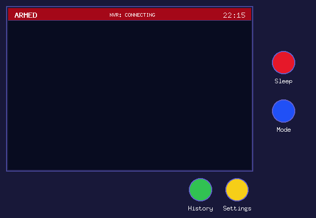

# Screens

See [shared rules](README.md) for mode, ACK and navigation behavior. Sketches show
placement, not exact pixel dimensions. Names below are synthetic examples.

## Standby

Implemented on macOS. This preview is rendered at the logical display resolution;
its clock and connection state are illustrative. The four circles are physical
controls on the case, not touch buttons inside the LCD.



```text
┌──────────────────────────────────────────────┐
│ ARMED              <status>            22:15  │
│                                              │      🔴 Sleep
│                   Empty                      │
│                                              │      🔵 Mode
│                                              │
└──────────────────────────────────────────────┘
                                🟢      🟡
                              History Settings
```

All actions drawn to the right/below the LCD in these sketches refer to the physical case buttons. Their colors stay fixed; captions depend on the screen.

The main area stays empty while waiting. There is no default camera preview.
The red Sleep button blanks the LCD without changing monitoring mode, the NVR
subscription or current audio. Any physical button wakes it; that first press is
consumed and must not also open a view or change mode. Keyboard input also wakes
the screen; even Escape only wakes it while asleep.

The blue Mode button cycles **ARMED → MUTED → DISARMED → ARMED**. The header
shows the resulting mode. MUTED records new alarms without sound; DISARMED ignores
new detections. Mode changes never replay existing alarms. History currently opens a placeholder; Settings shows the menu below with
unavailable sections marked WKRÓTCE. Both retain the physical Back action. Mouse clicks activate on release, and dragging
off a circular physical button cancels it. Keyboard focus follows Tab/arrows; Enter activates it. Clicks inside the standby LCD do not activate the case controls.

The normal app reads local config and shows the reconnecting NVR subscription's
status. macOS checks the local route to the NVR every 250 ms, independently of
TCP. A route loss invalidates ONLINE and cancels the stream; restoring a route
starts a fresh connection, which becomes ONLINE only after a valid message.
A separate 15-second deadline without a complete valid message also reconnects,
even if partial bytes arrive or the configured TCP timeout is longer.
Received detection messages do not yet trigger GUI alarms. Missing or
invalid config leaves the controls usable and shows a configuration status.

## History

```text
ARMED                  History               22:15

┌────────────────────────────┐
│ Snapshot                   │       Back
│   ┌──────┐                 │
│   │person│                 │
│   └──────┘                 │
└────────────────────────────┘
<when>  <camera / detection>     2/15   Prev  Next
```

Show one stored event with its snapshot and detection rectangle. Prev/Next
browses records; Back returns to Standby. An empty history shows an empty state
and Back. A missing snapshot does not hide the record's metadata.

**There is no Clear or manual delete action.** Automatic storage retention is
responsible for removing old eligible records.

## Alarm

```text
ALARM                  <status>              22:15

┌────────────────────────────┐
│ Snapshot                   │       ACK
│   ┌──────┐                 │       ↓
│   │person│                 │       Back
│   └──────┘                 │
└────────────────────────────┘
<when>  <camera / detection>      1/3   Prev  Next
```

ACK is replaced by Back after all currently received alarms are acknowledged;
the two are successive states of the action. ACK always covers all cameras,
regardless of which record is visible. Back returns to Standby and does not
delete history. If a new alarm arrives after ACK, the action returns to ACK.

Prev/Next allows browsing concurrent alarms. Keep the current selection when
another camera alarms. The rectangle describes the detection payload; snapshot
capture may happen later, so the image is not guaranteed to show that exact pose.

## Settings

The menu layout is implemented with descriptions and Polish glyphs. Its four
sections are currently unavailable and labelled WKRÓTCE; no active chevrons or
selection highlight imply functionality that is not yet implemented.

```text
ARMED                  Settings              22:15

Ustawienia obszaru
Harmonogram
Głośność / Test dźwięku
Diagnostyka

                                       Back
```

Once implemented, Ustawienia obszaru opens the camera list. Harmonogram opens the
[schedule editor](schedule.md). Audio settings provide volume and a sound test.
Diagnostics shows connection/time/storage status without credentials or raw NVR
responses. Back returns to Standby.

## Area: camera list

```text
ARMED              Ustawienia obszaru         22:15

1  Backyard 1
2  Backyard 2
3  Garage
4  Pool
…
                                       Back
```

Read camera numbers and names from the NVR. Selecting one opens its area editor.
Do not duplicate discovery data in connection configuration. Channel slots
reported by the NVR are not proof that every slot has a connected camera.
Discovery errors leave Back available and show a retry action.

## Area editor

```text
ARMED                  Backyard 1            22:15

┌────────────────────────────┐
│ Snapshot + 32 × 20 grid     │       Save
│ Selected cells highlighted │       Back
│                            │
└────────────────────────────┘
<zoom / selection controls>
```

Touch selects or deselects cells. Provide magnification for precise selection.
Keep the complete camera frame and exclude letterboxed margins from selection.
Save persists the selected cells for this camera atomically. Back leaves without
saving the draft. An incoming alarm preserves the draft for returning to it.

Snapshot refresh and zoom control placement will be settled with the rendered
editor. No live video is required.
